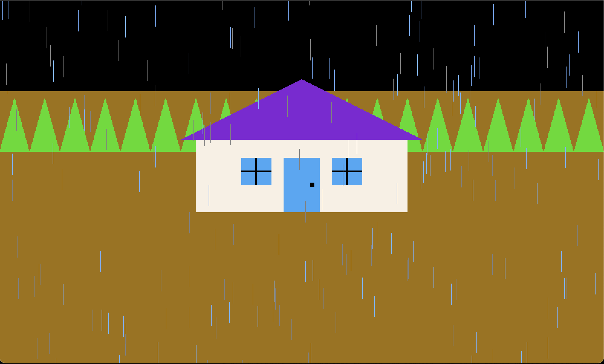
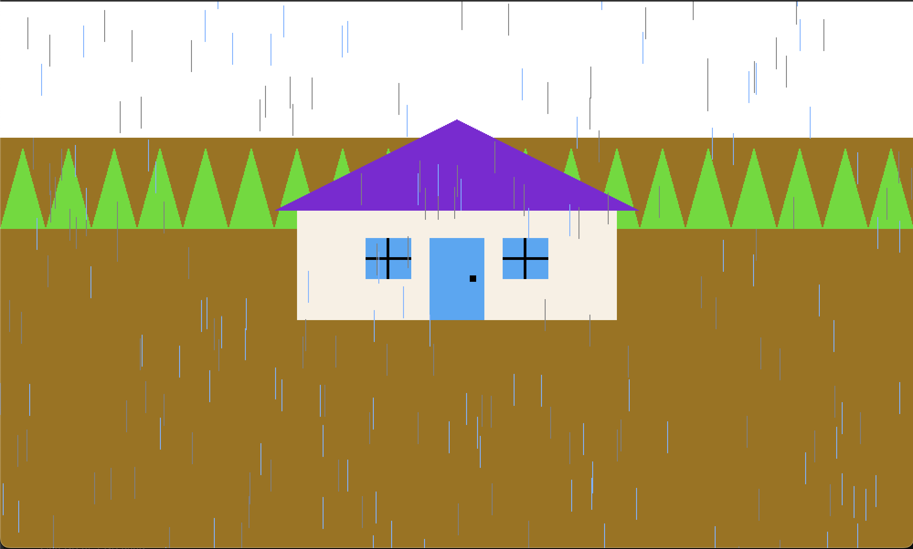
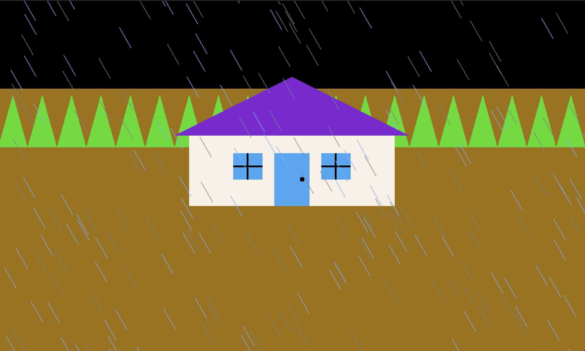
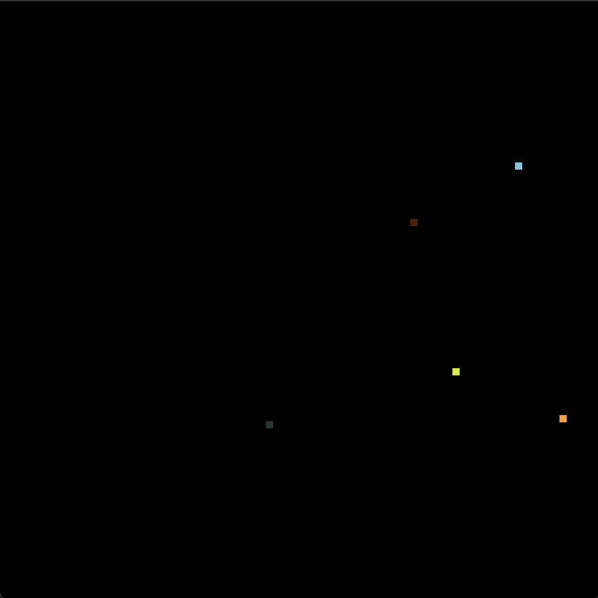
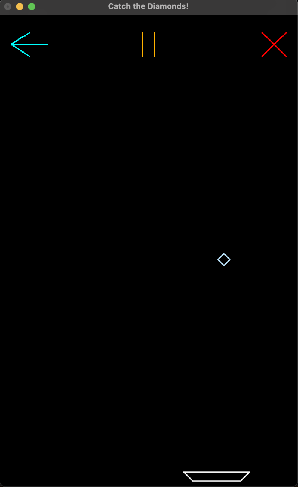
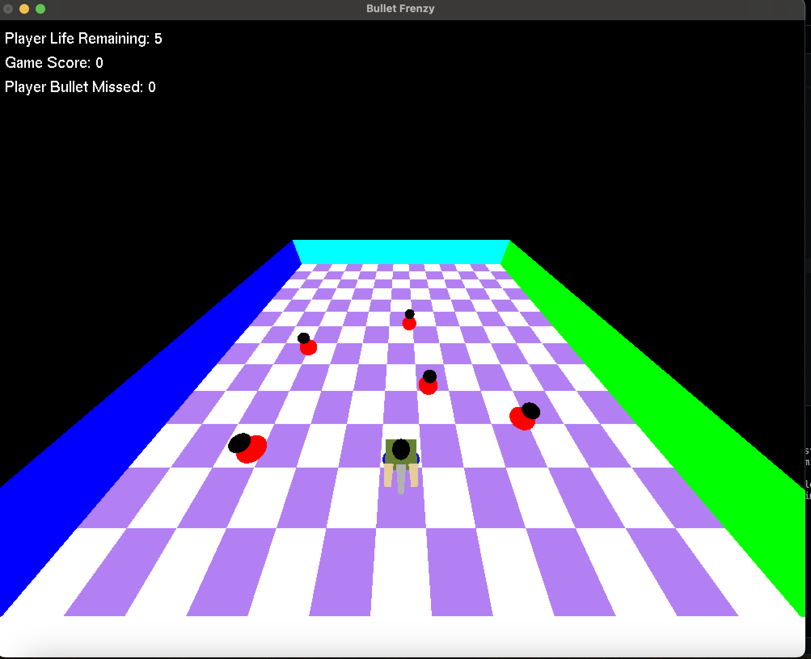

# CSE423 – Computer Graphics Lab (BRAC University)

Lab assignments from CSE423 (Computer Graphics) at BRAC University, written
in **Python** with **PyOpenGL** and **GLUT**. They progress from a static 2D
scene built from primitives, to animation and user input, to a raster line
algorithm with collision detection, and finally a 3D game with a
perspective camera.

| Lab | Program | Topics |
|-----|---------|--------|
| [01](#lab-01--house-in-rainfall) | House in Rainfall | 2D primitives, animation, keyboard input |
| [02](#lab-02--the-amazing-box) | The Amazing Box | Mouse input, moving and bouncing points, blinking |
| [03](#lab-03--catch-the-diamonds) | Catch the Diamonds | Midpoint line algorithm (8-zone), AABB collision, 2D game |
| [04](#lab-04--bullet-frenzy) | Bullet Frenzy | 3D modeling, perspective camera, 3D shooter game |

## Lab 01 – House in Rainfall

[house_in_rainfall.py](Lab01/house_in_rainfall.py)

A 2D scene of a house, trees, and a field, built entirely from OpenGL
triangles, lines, and points, with 220 animated raindrops falling over it.

| Control | Action |
|---------|--------|
| ← / → | Bend the rain left or right, as if the wind changes direction |
| `d` | Gradually brighten the sky toward day |
| `n` | Gradually darken the sky toward night |

| Rainfall | Day/night transition | Wind direction change |
|----------|----------------------|-----------------------|
|  |  |  |

## Lab 02 – The Amazing Box

[the_amazing_box.py](Lab02/the_amazing_box.py)

Points that bounce around inside the window.

| Control | Action |
|---------|--------|
| Right-click | Create a point with a random color at the cursor, moving diagonally |
| Left-click | Toggle blinking for all points |
| ↑ / ↓ | Double or halve the speed of all points |
| Space | Freeze or unfreeze everything (input is ignored while frozen) |



## Lab 03 – Catch the Diamonds

[catch_the_diamonds.py](Lab03/catch_the_diamonds.py)

A 2D game where you move a catcher to catch falling diamonds. Every shape
on screen, including the diamond, the catcher, and the buttons, is drawn
with my own implementation of the **midpoint line algorithm**, using only
`GL_POINTS`. Lines in any direction are handled by converting them to
zone 0 and back (8-zone conversion).

- **AABB collision detection** between the diamond and the catcher
- Each catch adds to the score, gives the next diamond a new random color, and makes it fall faster
- Movement is based on elapsed time, so the speed stays the same at any frame rate
- The game ends when a diamond is missed

| Control | Action |
|---------|--------|
| ← / → | Move the catcher |
| `c` | Toggle cheat mode (the catcher follows the diamond automatically) |
| Arrow button (top left) | Restart |
| Pause/play button (top center) | Pause or resume |
| ✕ button (top right) | Exit |



## Lab 04 – Bullet Frenzy

[bullet_frenzy.py](Lab04/bullet_frenzy.py)

A 3D shooter on a checkered arena. The player is modeled from cubes,
cylinders, and a sphere (`glutSolidCube`, `gluCylinder`, `gluSphere`), and
the scene is viewed through a `gluPerspective` camera positioned with
`gluLookAt`.

- 5 pulsating enemies chase the player, and each one that reaches the player costs a life
- Bullets travel in the direction the gun is facing, and each hit scores a point and spawns a new enemy
- The game ends when the player loses all 5 lives or misses 10 bullets, and the player falls over
- Cheat mode spins the gun and fires automatically whenever an enemy is in its line of sight

| Control | Action |
|---------|--------|
| `w` / `s` | Move forward or backward |
| `a` / `d` | Rotate the gun |
| Left-click | Fire |
| Right-click | Switch between third-person and first-person view |
| ← / → | Orbit the camera around the arena |
| ↑ / ↓ | Raise or lower the camera |
| `c` | Toggle cheat mode |
| `v` | Toggle the gun-following camera (in cheat mode) |
| `r` | Restart |



## How to run

Requires Python 3 and PyOpenGL:

```bash
pip install PyOpenGL
python3 Lab01/house_in_rainfall.py
```

- **macOS:** uses the built-in GLUT, so nothing else is needed.
- **Windows and Linux:** also install freeglut (for example, `sudo apt install freeglut3-dev` on Ubuntu).

## Tools
Python 3 · PyOpenGL · GLUT
